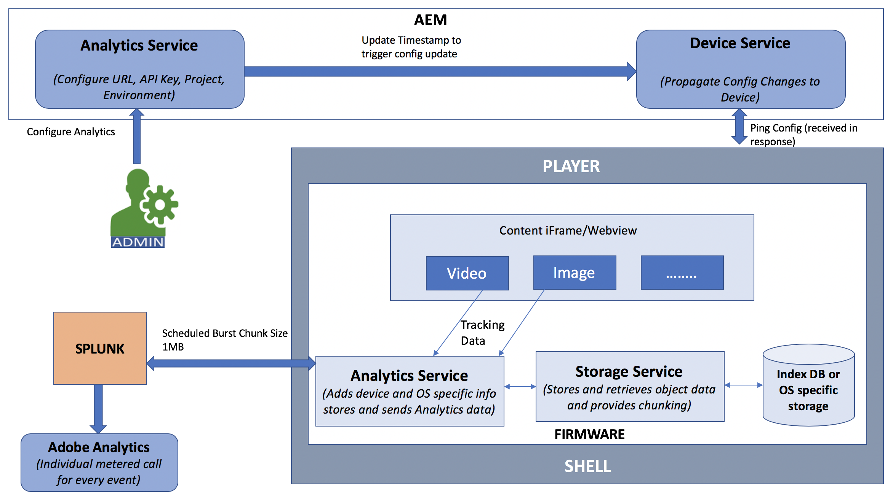
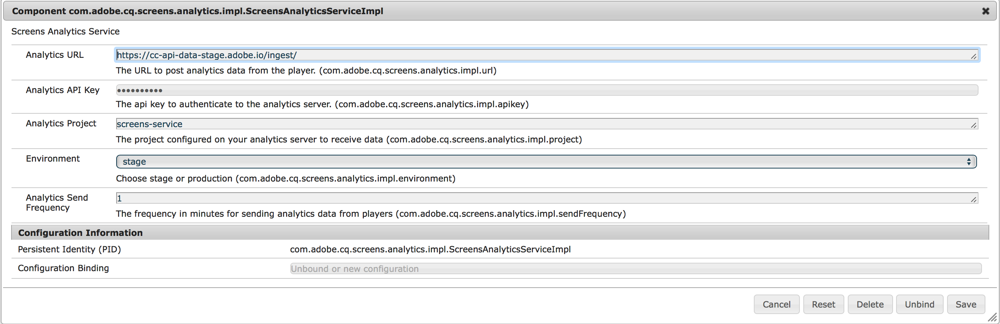

# Adobe Analytics Integration with AEM Screens {#adobe-analytics-integration-with-aem-screens}

>[!IMPORTANT]
>This content is valid for AEM on-premise/AMS (AEM 6.5LTS and AEM 6.5). For AEM as a Cloud Service Screens content refer to the [AEM as a Cloud Service guide](https://experienceleague.adobe.com/en/docs/experience-manager-cloud-service/content/screens-as-cloud-service/overview/introduction).

>[!CAUTION]
>
>This AEM Screens functionality is only available if you have installed minimum version of AEM 6.4.2 Feature Pack 2 or AEM 6.3.3 Feature Pack 4. For AEM Screens Cloud service customers, Contact your Adobe Relationship Manager to enable Adobe Analytics in Screens Cloud.

>[!NOTE]
>
>To get access to either of these Feature Packs, contact Adobe Support and request access. You can download the latest Feature Pack for AEM Screens from the [Software Distribution Portal](https://experience.adobe.com/#/downloads/content/software-distribution/en/aem.html) using your Adobe ID. 

This section covers the following topics:

* **Overview**
* **Architectural Details**
* **Configuring the Properties**

## Overview {#overview}

***AEM Screens*** uses Adobe Analytics, and with that you can achieve something unique in the market - cross-channel analytics that help correlate content shown in location with other data sources.

AEM Screens provides an out of the box integration with Adobe Analytics and provides you with a proof of play.

This section describes the following functionality involved with connecting an AEM Screens project with Adobe Analytics:

* Allows for proof of play reporting by device
* Allows for proof of play reporting by asset
* Ensures that all player events are captured and timestamped
* Ensures that all player events are stored locally if the play is not connected to a network
* Feedback loops can be created which track play events over time
* Lets the system edit content and layouts based on success criteria defined by the Content Author

Adobe Analytics Integration with AEM Screens thus enforces the following *goals*:

* Enable ROI from digital signage implementations
* Integrate Analytics as a foundation for future enablement of gathering and analyzing usage information

## Architectural Details {#architectural-details}

An AEM Screens customer wants to understand what content was shown at what time, and for how long (aggregated). This necessity is a common capability of a signage solution. Instead of building a separate analytics application, AEM Screens uses Adobe Analytics. The combination lets us achieve something unique in the market - cross-channel analytics that help correlate content shown in location with other data sources.

The following architectural diagram explains the Adobe Analytics Integration with AEM Screens:

## Enabling Adobe Analytics in AEM Screens {#enabling-adobe-analytics-in-aem-screens}

The Adobe Analytics settings can be configured from the OSGi console.

Navigate to **Adobe Experience Manager Web Console Configuration** so you can configure Adobe Analytics for AEM Screens.

## Screens Analytics: Enablement Flow {#screens-analytics-enablement-flow}

>[!CAUTION]
>
>Before you configure the properties, contact your Adobe Relationship Manager to create a ticket to obtain an **Analytics API Key** and **Analytics Project** for use with AEM Screens.

### Configuring the Properties {#configuring-the-properties}

>[!CAUTION]
>
>Before you configure the properties, contact your Adobe Relationship Manager to create a ticket to obtain an **Analytics API Key** and **Analytics Project** for use with AEM Screens.

The following table highlights the properties with their description for configure Adobe Analytics for AEM Screens:

<table>
 <tbody>
  <tr>
   <td><strong>Property</strong></td>
   <td><strong>Description</strong></td>
  </tr>
  <tr>
   <td><strong>Analytics URL</strong></td>
   <td>URL to post analytics data from the player.  
   For development/stage</em> - https://cc-api-data-stage.adobe.io/ingest/  <em>For Production</em> - https://cc-api-data.adobe.io/ingest/   </td>
  </tr>
  <tr>
   <td><strong>Analytics API Key</strong></td>
   <td>API key to authenticate to the Adobe Analytics server (provided by the Accounts Manager).</td>
  </tr>
  <tr>
   <td><strong>Analytics Project</strong></td>
   <td>AEM Screens project configured on your analytics to receive data (provided by the Accounts Manager).</td>
  </tr>
  <tr>
   <td><strong>Environment</strong></td>
   <td>
Stage or Production environment (choose either Stage or Production).
</td>
  </tr>
  <tr>
   <td><strong>Analytics Send Frequency</strong></td>
   <td>Frequency in minutes for sending analytics data from the players. By default, it is set to 15 mins.</td>
  </tr>
 </tbody>
</table>

>[!NOTE]
>
>By default, the **Analytics Send Frequency** is 15 minutes.

#### Using Adobe Analytics Service in AEM Screens {#using-adobe-analytics-service-in-aem-screens}

This scenario invokes the Analytics API through REST calls from an analytics service in the firmware. It also instruments AEM screens-core components to create and send events specific to a particular use case. All this functionality while allowing extensibility where any custom message can be sent to Analytics from a custom-developed channel.

Analytics events are stored offline in indexedDB and later chunked and sent to the cloud.

>[!NOTE]
>
>To learn more about the ***Sequencing*** and ***Standard Data Model for Events***, see **[Configuring Adobe Analytics for AEM Screens](configuring-adobe-analytics-aem-screens.md)**.

