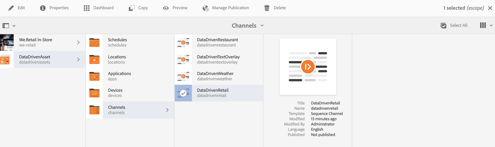
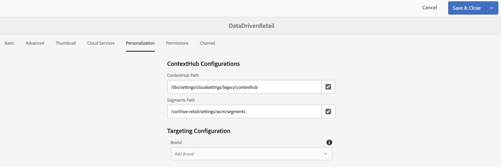
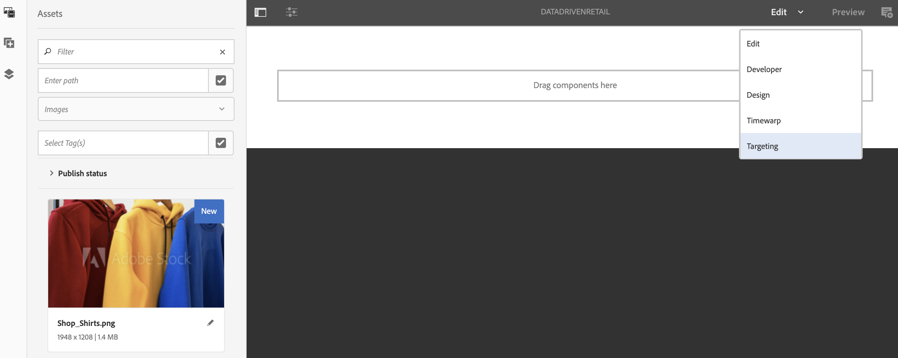

# Authoring with Data Triggers {#authoring-with-data-triggers}

This section highlights how to enable targeting in your channels.

>[!IMPORTANT]
>
>The minimum version that supports data triggers in an AEM Screens channel is AEM 6.5.3 Feature Pack 3.

## Prerequisites {#prereqs}

Before you follow the steps below to enable targeting in channels, learn the [Key Terms in Configuring in AEM Screens](configuring-context-hub.md) required for understanding ContextHub and Targeting in AEM Screens.

>[!IMPORTANT]
>
>It is recommended that you understand and set up ContextHub configurations, before enabling targeting in an AEM Screens channel.

Follow the links below for more information:

1. **[Setting up Data Store](configuring-context-hub.md)**
1. **[Setting up Audience Segmentation](configuring-context-hub.md)**

When you have completed the preceding steps, you are ready to enable targeting in your channels.

## Authoring with Data Triggers Overview {#author-targeting}

>[!VIDEO](https://video.tv.adobe.com/v/31921)

## Enabling Targeting in an AEM Screens Channel {#enabling-targeting}

Follow the steps below to enable targeting in your channels.

1. Navigate to one of the AEM Screens channels. The following steps demonstrate how to enable targeting by using **DataDrivenRetail** *(sequence channel)* created in an AEM Screens channel.

1. Click the channel **DataDrivenRetail** and click **Properties** from the action bar.

   

1. Click the **Personalization** tab so you can set up the ContextHub configurations and click the ContextHub and Segments path.

    1. Click the **ContextHub Path** as **libs** > **settings** > **cloudsettings** > **default** > **ContextHub Configurations** and click **Click**.

    1. Click the **Segments Path** as **conf** > **`We.Retail`** > **settings** > **wcm** > **segments** and click **Click**.

    1. Click **Save & Close**.

   >[!NOTE]
   >
   >Use the ContextHub and the Segments path, where you initially saved your context hub configurations and segments.

   

1. Navigate and click the **DataDrivenRetail** from **DataDrivenAssets** > **Channels** and click **Edit** from the action bar. Drag and drop the assets in your channel editor.

   >[!NOTE]
   >
   >If you have set up everything correctly, you see the **Targeting** option in the drop-down from the editor, as shown in the figure below.

   

1. Click **Targeting**.

1. Click **Brand** and the **Activity** from the drop-down menu and click **Start Targeting**.

### Learn More: Example Use Cases {#learn-more-example-use-cases}

After you have configured ContextHub for your AEM Screens project, you can follow the different Use Cases to understand how data triggered assets plays a vital role in different industries:

1. **[Retail Inventory Targeted Activation](retail-inventory-activation.md)**
1. **[Travel Center Temperature Activation](local-temperature-activation.md)**
1. **[Hospitality Reservation Activation](hospitality-reservation-activation.md)**
