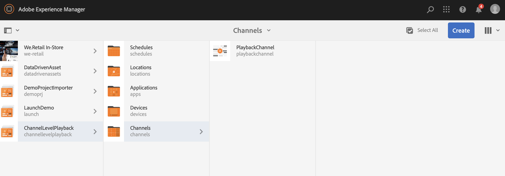
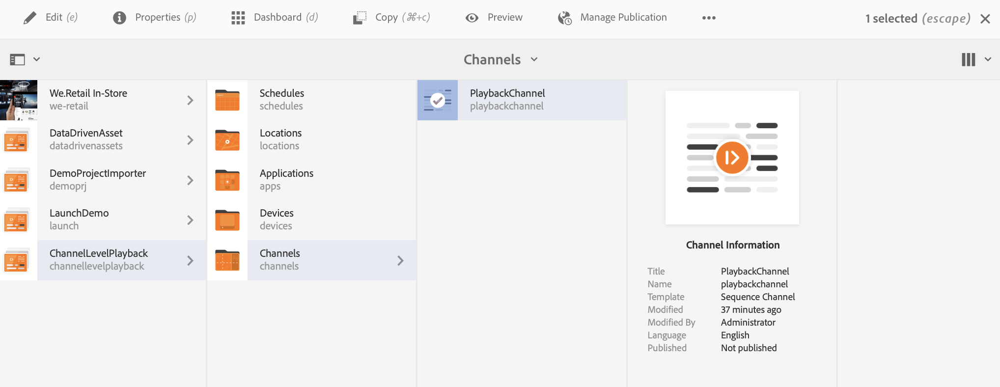
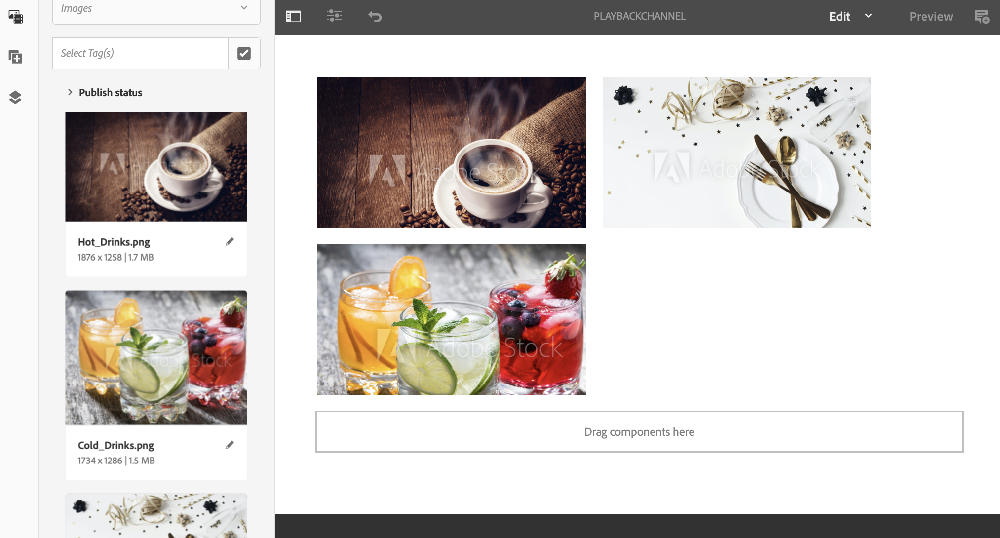
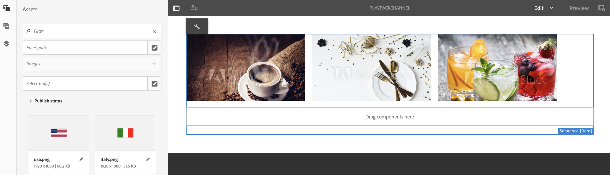
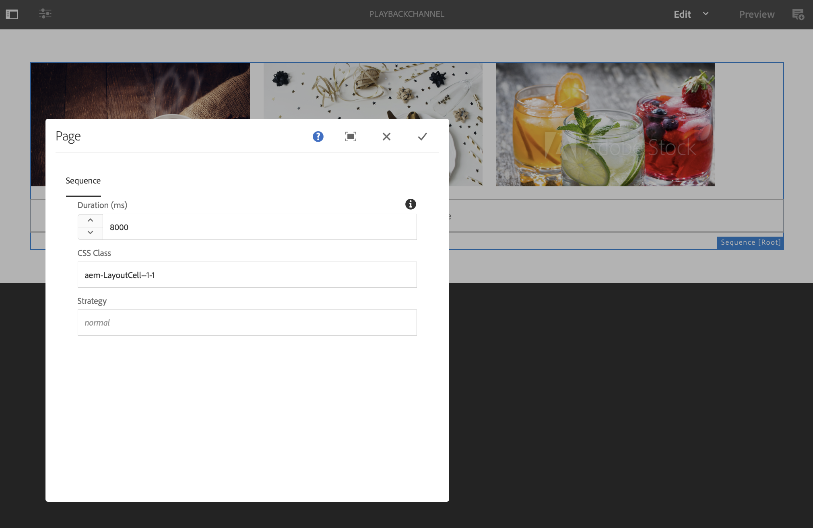
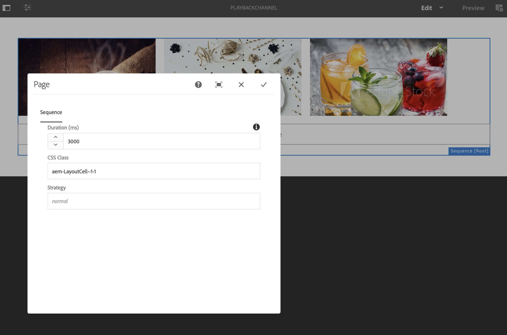

# Channel Level Bulk Image Playback Duration {#channel-level-bulk-image-playback-duration}

## Overview {#overview}

When you create a sequence channel and add images to it, by default, all images assume the playback duration defined in the Channel level configuration. Any individual image can still override the default and have a different playback duration. This ability is accomplished by editing the playback duration of the specific image component.

### Prerequisites {#prerequisites}

Before beginning to implement this functionality, make sure you have set up a project as a prerequisite to start implementing this functionality. For example,

1. Create an AEM Screens project example, **ChannelLevelPlayback**. 

1. Create a sequence channel as **PlaybackChannel** under the **Channels** folder.

1. Add content to **PlaybackChannel**.

## Editing Channel Level Image Playback Duration Assignment {#editing-channel-level-image-playback-duration-assignment}

The section below explains how you can edit the playback duration of content in an AEM Screens channel.

### Updating the Playback Duration for Images in a Channel {#updating-the-playback-duration-for-images-in-a-channel}

Follow the steps below to learn how to update Channel Level Image Playback Duration Assignment:

1. Navigate to the sequence channel **PlaybackChannel**.

   

1. Click **Edit** from the action bar.

   

1. Add two or more images in the channel editor, as shown in the figure below.

   

1. Click all the images in the channel and click the wrench icon on the top-left (as shown in the figure below) so you can open the Channel level Configure dialog box.

   

1. The **Page** dialog box opens.

   >[!NOTE]
   >By default, the images in a channel are set to a playback duration of 8 seconds.

   

   Edit the **Duration** from 8000 (milliseconds) to 3000 (milliseconds), that is, 3 seconds. Click the check mark on the top right of the **Page** dialog box so you can save your changes.

   

### Viewing the Result {#viewing-the-result}

After you have updated the channel playback duration (in this example, all three images), notice that the images now play for 3 seconds rather than 8 seconds (the default value).

