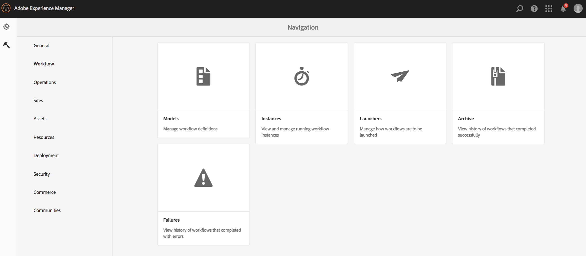
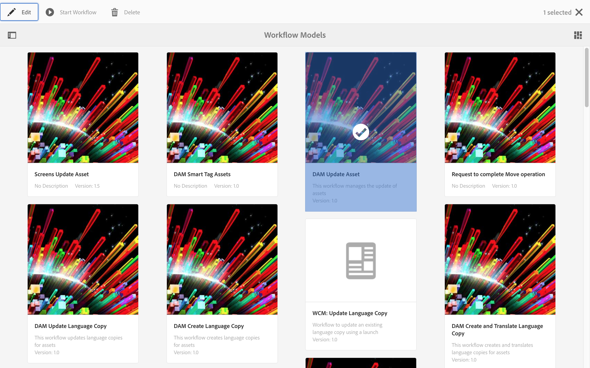
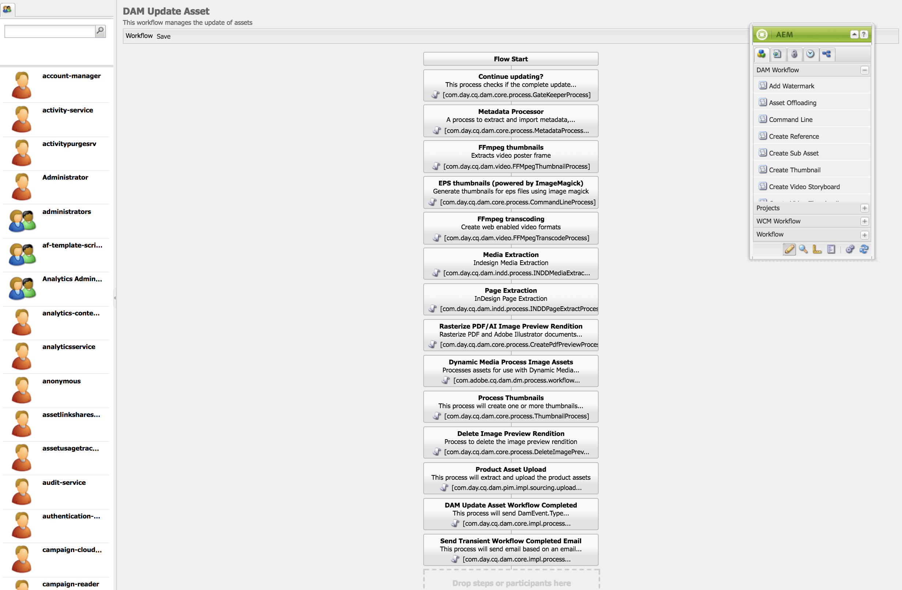
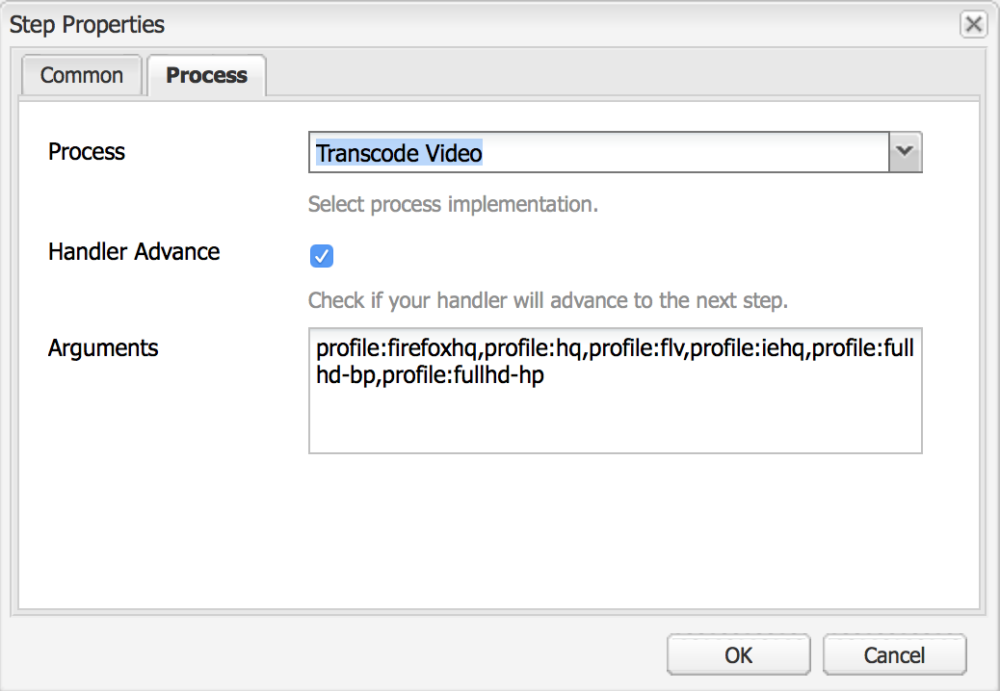
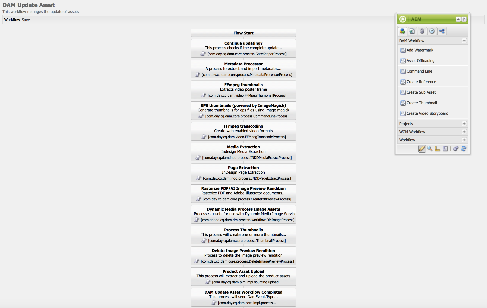
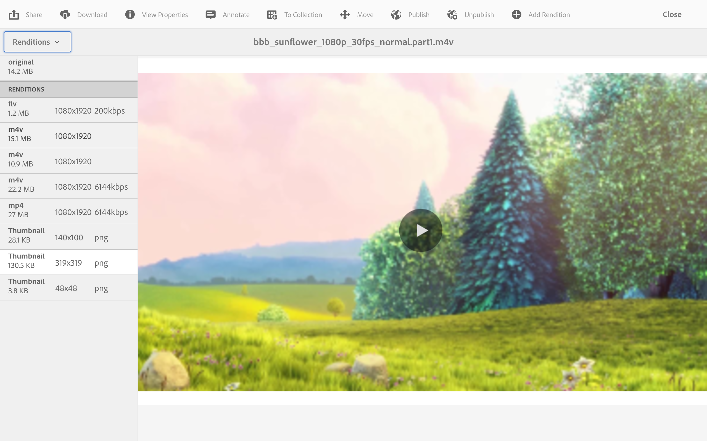
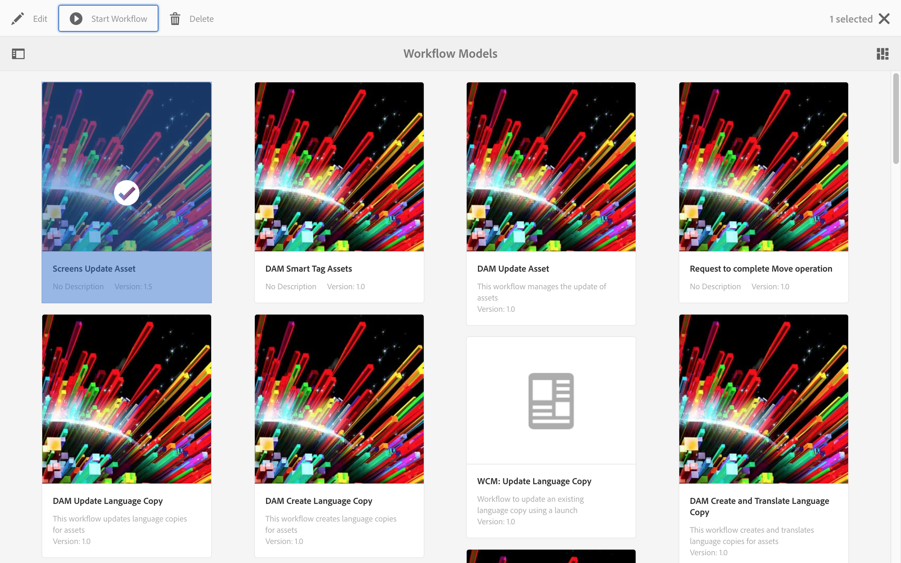
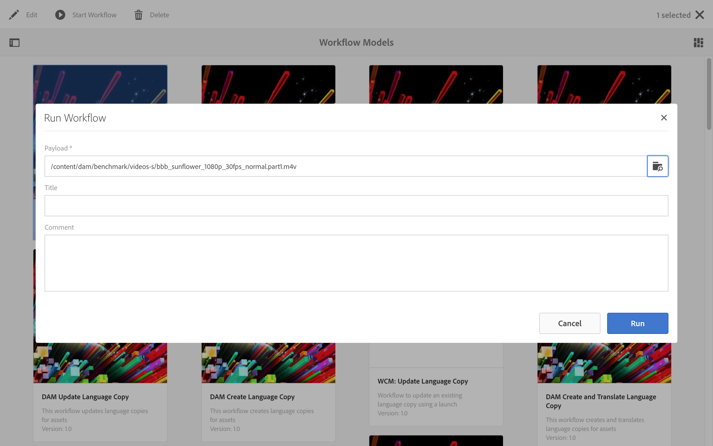
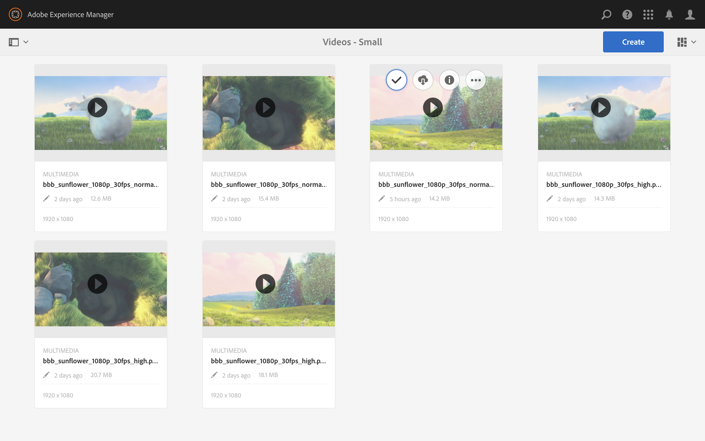
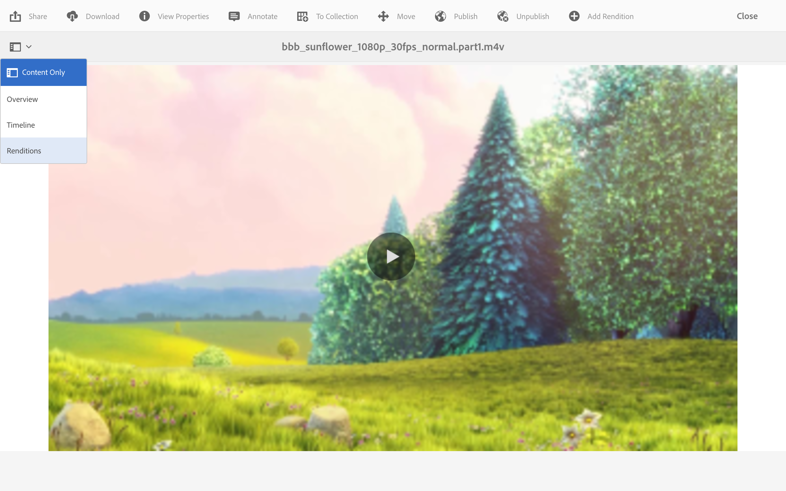

# Video Renditions {#video-renditions}

>[!IMPORTANT]
>This content is valid for AEM on-premise/AMS (AEM 6.5LTS and AEM 6.5). For AEM as a Cloud Service Screens content refer to the [AEM as a Cloud Service guide](https://experienceleague.adobe.com/en/docs/experience-manager-cloud-service/content/screens-as-cloud-service/overview/introduction).

You can generate manual and automatic full HD renditions. The following section describes the workflow to add renditions to your assets.

## Automatically Generating Full HD Renditions {#automatically-generating-full-hd-renditions}

>[!NOTE]
>
>In case the AEM Screens video renditions do not play optimally on your device, contact the hardware vendor for the specifications of the video. Doing so helps you to get the best performance on the device. It helps you to create your own custom video profile where you provide the appropriate parameters for FFMPEG to generate your rendition. Then, use the steps below to add your custom video profile to the list of profiles.
>
>Also, see [Troubleshooting Videos](troubleshoot-videos.md) to debug and troubleshoot video playing in your channel.

Follow the steps below to generate full HD renditions automatically:

1. Click the Adobe Experience Manager link (top-left) and click the hammer icon so you can click **Workflow**.

   Click **Models**.

   

1. In the workflow model management, click the **DAM Update Asset** model and click **Edit** from the action bar.

   

1. In the **DAM Update Asset** window, double-click the **FFmpeg transcoding** step.

   

1. Click the **Process** tab.
1. Enter the full HD profiles to the list in **Arguments** as the following:
   ***`,profile:fullhd-bp,profile:fullhd-hp`***
1. Click **OK**.

   

1. Click **Save** on the top-left of the **DAM Update Asset** screen.

   

1. Navigate to **Assets** and upload a new video. Click the video and open the Renditions side rail. Notice the two full HD videos.

   

1. Open **Renditions** from the side rail.

   

1. Notice two new full HD renditions.

   

## Manually Generating Full HD Renditions {#manually-generating-full-hd-renditions}

Follow the steps below to generate full HD renditions manually:

1. Click the Adobe Experience Manager link (top left) and click the hammer icon so you can click tools and click **Workflow**.

   Click **Models**.

   

1. In workflow model management, click the **Screens Update Asset** model, and click the **Start Workflow** to open the **Run Workflow** dialog box.

   

1. Click the desired video in the **Payload** and click **Run**.

   

1. Navigate to **Assets**, drill down to your asset, and click it.

   

1. Open the **Renditions** side rail. Notice the new full HD renditions.

   
