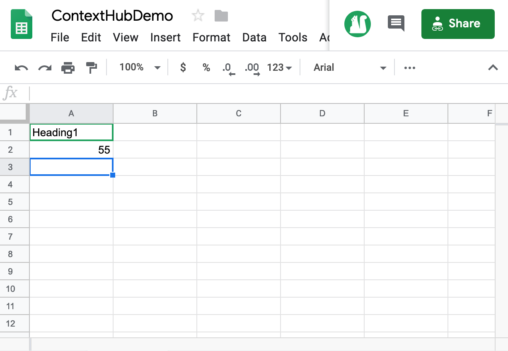
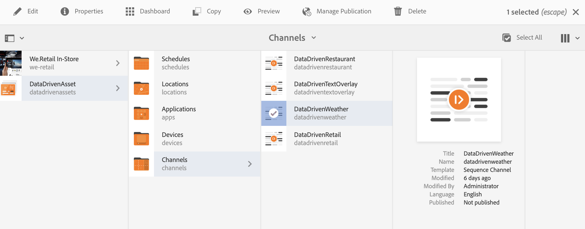
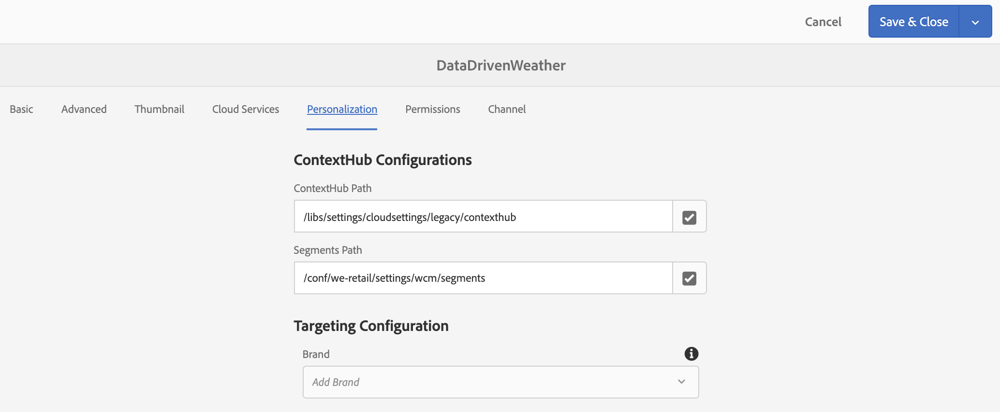
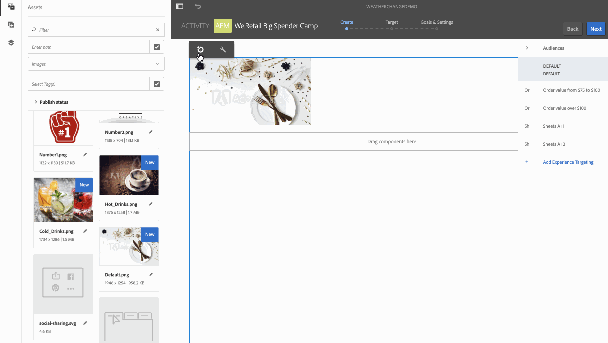
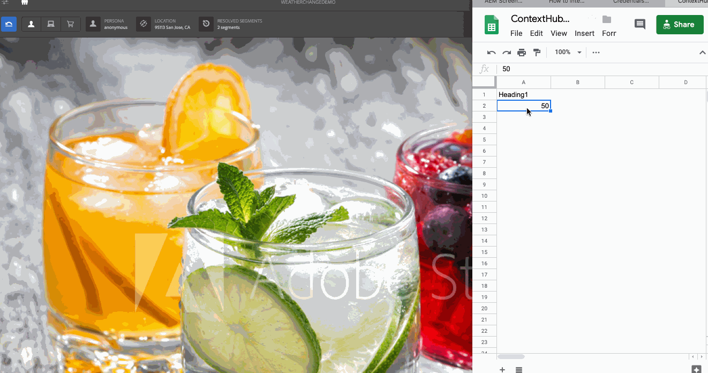

# Travel Center Temperature Activation {#travel-center-temperature-activation}

>[!IMPORTANT]
>This content is valid for AEM on-premise/AMS (AEM 6.5LTS and AEM 6.5). For AEM as a Cloud Service Screens content refer to the [AEM as a Cloud Service guide](https://experienceleague.adobe.com/en/docs/experience-manager-cloud-service/content/screens-as-cloud-service/overview/introduction).

The following use case demonstrates the usage of travel center local temperature activation based on the values populated in Google Sheets.

## Description {#description}

For this use case, if the value in Google Sheets is less than 50, then an image with hot drinks displays. If the value is greater than or equal to 50, then an image with cold drinks displays. If there is some other value or no value at all, the player displays a default image.

## Preconditions {#preconditions}

Before you start implementing the travel center local temperature activation, learn how to set up ***Data Store***, ***Audience Segmentation*** and ***Enable Targeting for Channels*** in an AEM Screens Project.

See [Configuring ContextHub in AEM Screens](configuring-context-hub.md) for detailed information.

## Basic Flow {#basic-flow}

Follow the steps below to implement the Travel Center Local Temperature Activation use case:

1. **Populating the Google Sheets**

    1. Navigate to the ContextHubDemo Google Sheet.
    1. Add a column with **`Heading1`** with corresponding value for temperature.

   

1. **Configuring the segments in Audiences as per the requirements**

    1. Navigate to the segments in your audience (See ***Step 2: Setting up Audience Segmentation*** in **[Configuring ContextHub in AEM Screens](configuring-context-hub.md)** page for more details).

    1. Click the **Sheets A1 1** and click **Edit**.

    1. Click the comparison property and click the configuration icon.
    1. Click **googlesheets/value/1/0** from the drop-down in **Property name**

    1. Click the **Operator** as **greater-than-or-equal** from the drop-down menu

    1. Enter the **Value** as **50**

    1. Similarly, select the **Sheets A1 2** and click **Edit**.

    1. Click the **Comparison Property - Value** and select the configuration icon.
    1. Click **googlesheets/value/1/0** from the drop-down in **Property name**

    1. Click the **Operator** as **less-than** from the drop-down menu

    1. Enter the **Value** as **50**

1. Navigate and select your channel () and click **Edit** from the action bar. In the following example, **DataDrivenWeather**, a sequential channel is used to showcase the functionality.

   >[!NOTE]
   >
   >Your channel should already have a default image and the Audiences should be pre-configured as described in [Configuring ContextHub in AEM Screens](configuring-context-hub.md).

   

   >[!CAUTION]
   >
   >Your **ContextHub** **Configurations** using the channel **Properties** > **Personalization** tab should already be set up.

   

1. Click **Targeting** from the editor and click **Brand** and the **Activity** from the drop-down menu and click **Start Targeting**.

   

1. **Checking the Preview**

    1. Click **Preview.** Also, open your Google Sheet and update its value.
    1. Change the value to less than 50. You can view an image of a cold drink. If the value in Google Sheets is 50 or greater, you should see an image of a hot drink.

    

