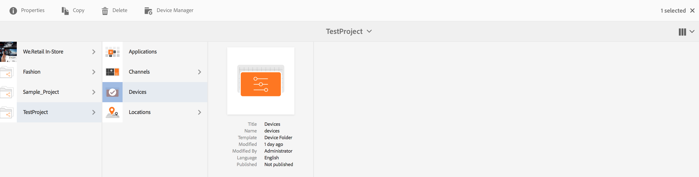
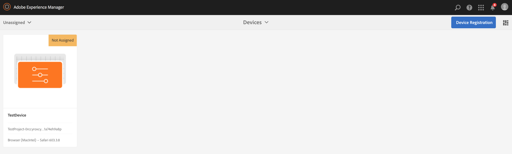
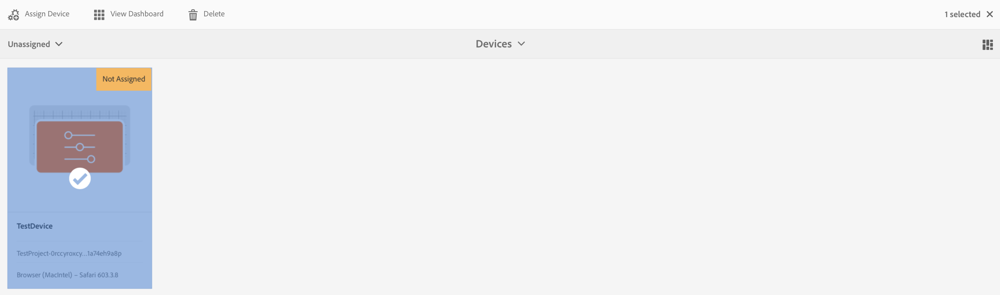
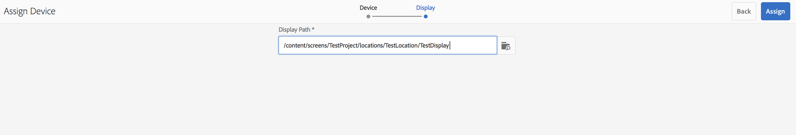
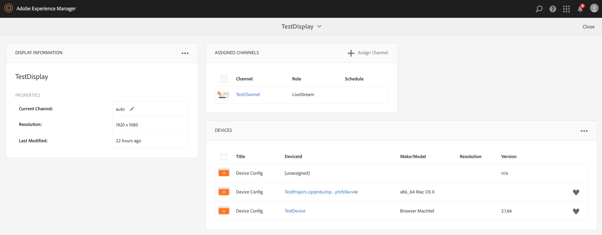
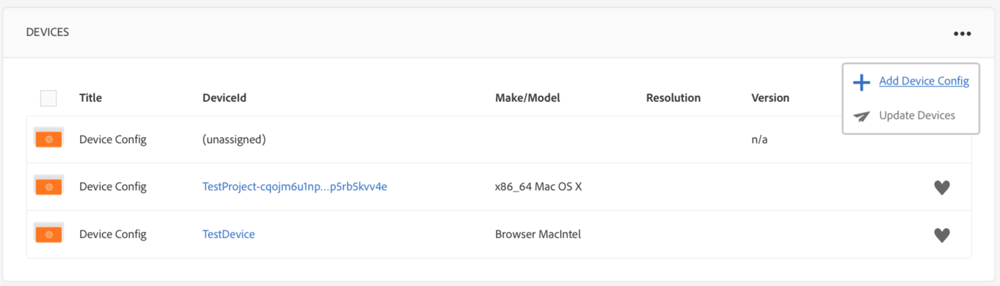
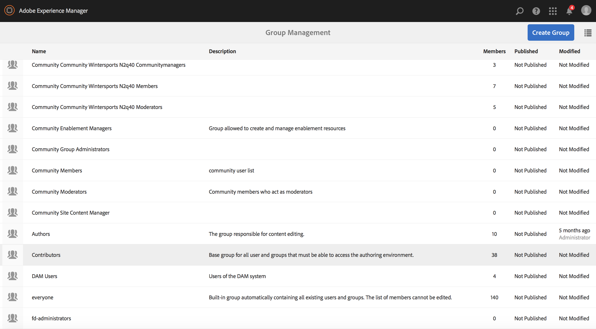

# Manage devices {#managing-devices}

This page describes the device assignment.

The Devices console lets you access the device manager to assign your device to a display.

>[!CAUTION]
>
>Before assigning your device, register it. See [Device Registration](device-registration.md).

## Device Assignment {#device-assignment}

Follow the steps below to assign a device to a display:

1. Navigate to the Devices folder of your project, for example

   `http://localhost:4502/screens.html/content/screens/TestProject`

   

1. Click your **Devices** folder and click **Device Manager** in the action bar. The assigned and unassigned devices display.

   

1. Click an unassigned device from the list, then in the action bar, click **Assign Device**.

   

1. Click the display that you want to assign the device to from the list, and click the **Assign**.

   

1. Click the **Finish** to complete the assignment process.

   The display dashboard displays the assigned device in the **DEVICES** panel.

   

   Click the (**...**) on the top-right corner of the **DEVICES** panel to either add device config or update the devices.

   

>[!NOTE]
>
>Every time the first device is added to a new Screens project, a user group is created.
>For instance, if the project node name is *we-retail*, then the user group name is *screens-we-retail-devices*.
>This group is added as a member of the **Contributors** group, as shown in the figure below:

### The Next Steps {#the-next-steps}

After you are familiar with assigning channel to a display, see t[Monitor and troubleshoot](monitoring-screens.md).
