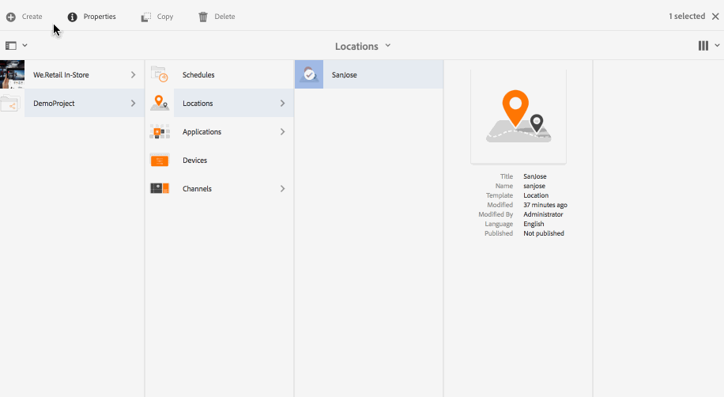
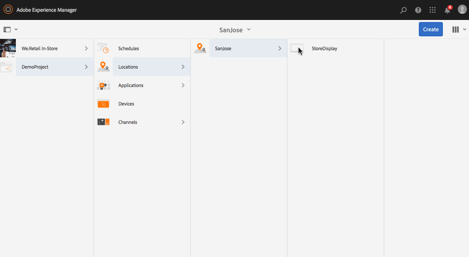
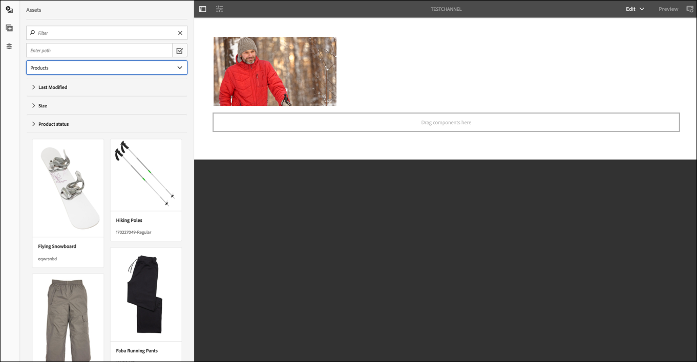
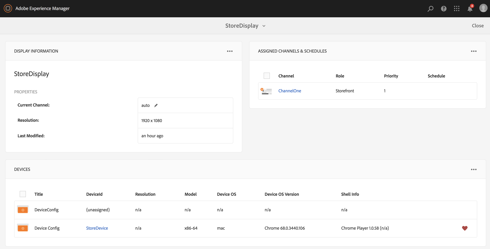
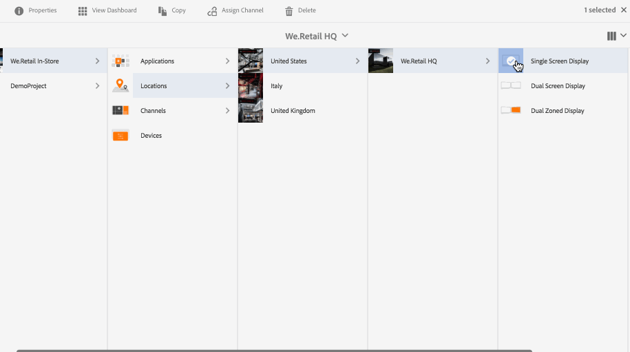
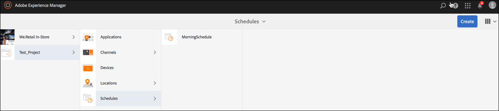

# Creating and Managing Displays {#creating-and-managing-displays}

>[!IMPORTANT]
>This content is valid for AEM on-premise/AMS (AEM 6.5LTS and AEM 6.5). For AEM as a Cloud Service Screens content refer to the [AEM as a Cloud Service guide](https://experienceleague.adobe.com/en/docs/experience-manager-cloud-service/content/screens-as-cloud-service/overview/introduction).

A display is a virtual grouping of screens that are positioned next to each other. The display is permanent in respect to an installation. It is the object content authors work with and always reference to as logical display rather than their physical counter parts.

When you create a location, you have to create a display for your location.

This page shows creating and managing displays for Screens.

**Pre-requisites**:

* [Configuring and Deploying Screens](configuring-screens-introduction.md)
* [Create and Manage Screens Project](creating-a-screens-project.md)
* [Create and Manage Channels](managing-channels.md)
* [Create and Manage Locations](managing-locations.md)

## Creating a New Display {#creating-a-new-display}

>[!NOTE]
>
>Create a location before creating a display. See [Create and Manage Locations](managing-locations.md) for more information.

1. Navigate to the appropriate location, for example `http://localhost:4502/screens.html/content/screens/TestProject`.
1. Click your location folder and click **Create** that is next to the plus icon in the action bar. 
1. Click **Display** from the **Create** wizard, then click **Next**.
1. Enter your **Name** and **Title** for your display location.
1. Under the **Display** tab, choose the details of the Layout. Choose the desired **Resolution**, such as **Full HD**. Choose the number of devices horizontally and vertically.
1. Click **Create**.

The display (*StoreDisplay*) is created and added to the location (*SanJose*).

When you have a display in position, the next step is to create a device config for that particular display.

>[!NOTE]
>
>**The Next Step**:
>
>When you create a display for your location, assign a channel to your display to use the content.
>
>See the [Assign Channels](channel-assignment.md) section to learn how to assign a channel to the display.

## Creating a New Device Config {#creating-a-new-device-config}

A device config acts as a placeholder for an actual digital signage device that is not yet installed.

1. Navigate to the appropriate display, for example, `http://localhost:4502/screens.html/content/screens/TestProject/locations/newlocation`.
1. Click your display folder and click **View Dashboard** in the action bar.
1. Click **+ Add Device Config** on the top-right of the **Devices** panel.

1. Click the **Device Config** as the required template and click **Next**.

1. Enter the properties as required and click **Create**.

The device config is created and added to the current display (in the following demonstration, the new device config is *DeviceConfig*).

>[!NOTE]
>
>When a device config is set to your display in the location, the next step will be to assign a channel to your display.
>
>As shown in the figure below, if the device config is displayed as unassigned in the **DEVICES** panel, if no channel is assigned to that particular device config.
>
>You should have a prior understanding of creating and managing channels. See [Create and Manage Channels](managing-channels.md) for more details.

## Display Dashboard {#display-dashboard}

The display dashboard provides you with different panels for managing display devices. It also lets you configure your device.

>[!NOTE]
>
>You can click the dashboard lists and trigger bulk actions on items, instead of going through each item individually.
>
>For example, the following image shows how you can click multiple channels from the display dashboard.

### Display Information Panel {#display-information-panel}

The **DISPLAY INFORMATION** Panel provides the display properties.

Click (**...**) in the top-right corner in the **DISPLAY INFORMATION** panel so you can view the properties and preview the display.

#### Viewing Properties {#viewing-properties}

Click **Properties** so you can view or change the properties of your display.

Also, you can adjust the event timer value for your interactive channel under the **Display** tab. The default value is set to *300 seconds*.

Use **CRXDE Lite**, to access the **idleTimeout** property, that is, `http://localhost:4502/crx/de/index.jsp#/content/screens/we-retail/locations/demo/flagship/single/jcr%3Acontent/channels`.

### Assigned Channels Panel {#assigned-channels-panel}

The **ASSIGNED CHANNELS** panel displays the assigned channels to this device.

### Devices Panel {#devices-panel}

The **DEVICES** Panel provides information on the device configurations.

Click (**...**) in the top-right corner in the **DEVICES** panel so you can add device configurations and update devices.

Also, click the device config to view properties, assign a device, or delete it completely.

#### The Next Steps {#the-next-steps}

When you complete creating a display for your location, assign a channel for your display.

See [Assign Channels](channel-assignment.md) for more details.

