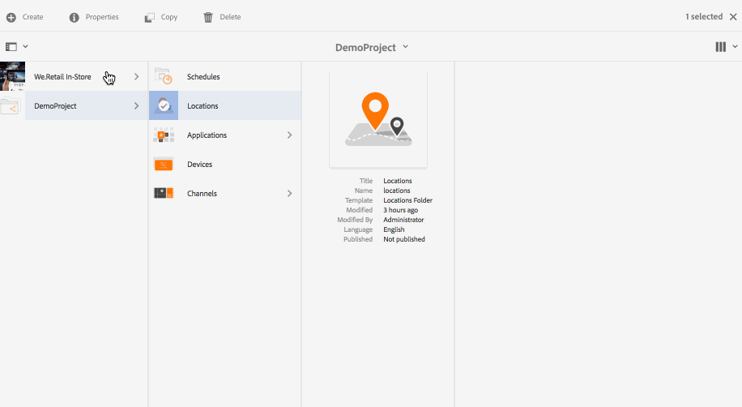
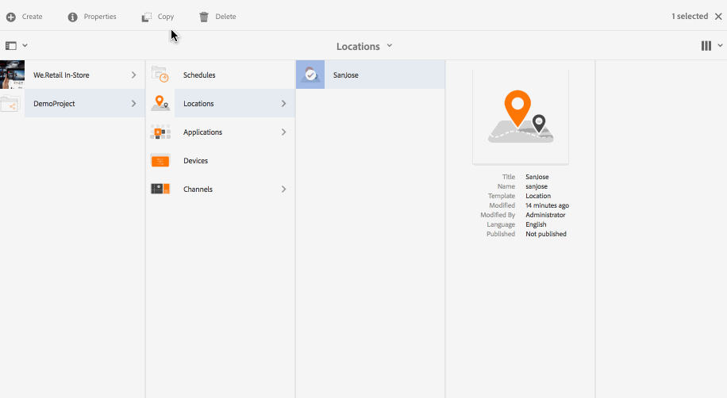

# Creating and Managing Locations {#creating-and-managing-locations}

>[!IMPORTANT]
>This content is valid for AEM on-premise/AMS (AEM 6.5LTS and AEM 6.5). For AEM as a Cloud Service Screens content refer to the [AEM as a Cloud Service guide](https://experienceleague.adobe.com/en/docs/experience-manager-cloud-service/content/screens-as-cloud-service/overview/introduction).

The locations host the configuration of the displays according to where the various screens are.

This page shows creating and managing locations for Screens.

**Pre-requisites**:

* [Configuring and Deploying Screens](configuring-screens-introduction.md)
* [Creating and Managing Screens Project](creating-a-screens-project.md)
* [Creating and Managing Channels](managing-channels.md)

## Creating a New Location {#creating-a-new-location}

After you create your project for Screens, follow the steps below to create a Location for a Screens project:

1. Click the Adobe Experience Manager link (top left) and then Screens. Alternatively, you can navigate directly to: `http://localhost:4502/screens.html/content/screens`.
1. Navigate to Screens project and click **Locations**.
1. Click **Create** next to the plus icon in the action bar.
1. Click the template **Location** from the wizard and click **Next**.
1. Enter the properties for **Title and Tags**, **More Titles and Description**, **On/Off Time**, and **Vanity URL**.
1. Click **Create** and the location is created and added to your locations folder.

See the steps below to understand creating a location for an AEM Screens project. For demonstration purposes, the new location (SanJose) is created under *DemoProject*.

After you create a location, create a display for your location.

### Editing Properties for a Location {#editing-properties-for-a-location}

To edit/access the properties of a location:

1. Click the location.
1. Click **Properties** from the action bar.

#### The Next Steps {#the-next-steps}

After you create a location, create a display for your location.

See [Creating and Managing Displays](managing-displays.md).

