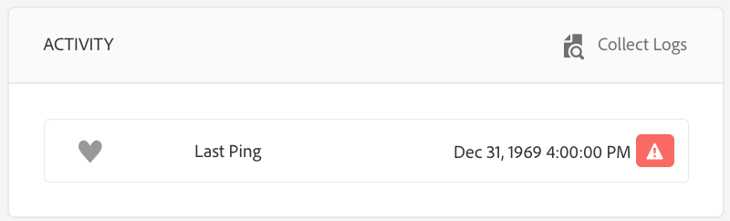
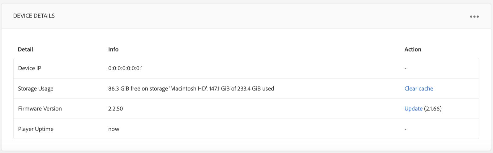

# Create and manage schedules {#creating-and-managing-schedules}

**Schedules** in AEM Screens let you organize channels into reusable groups. Doing so means that you do not have to repeat their assignment individually for each display on which you want to show your content.

Schedules, when combined with ***DayParting***, lets you set a global schedule with multiple channels running at specific times of the day, and reuse that set up for all your displays at once.

>[!NOTE]
>
>This AEM Screens functionality is only available if you have installed AEM 6.3 Sites Feature Pack 1. To get access to this Feature Pack, contact Adobe Support and request access. After you have the necessary permissions, you can download it from Package Share.

## Create a schedule {#creating-a-schedule}

You can create a schedule for your Screens project that can manage all the activities for your use case.

Follow the steps below to create a schedule for your channel:

1. Click the Adobe Experience Manager link (top left) and then Screens. Alternatively, you can go directly to: `http://localhost:4502/screens.html/content/screens`.
1. Navigate to Screens project and click **Schedules**.
1. Click **Create** from the action bar.
1. Click **Schedule** from the **Create** wizard and click **Next**.

1. Enter the **Name** and **Title** and click **Create**.

You can see a schedule folder with the designated name and title in your project.

## View dashboard {#viewing-dashboard}

After you have created a schedules folder in your project, you can view the details from the schedules dashboard.

Follow the steps below to view the schedule dashboard. The following example shows the dashboard of the `We.Retail` project:

1. Navigate to the **Schedules** folder of Screens (example, `We.Retail`) project.

   

1. Click **Dashboard** from the action bar.

   You can view three different panels such as **SCHEDULE INFORMATION**, **ASSIGNED CHANNELS**, and **ASSIGNED DISPLAYS**.

   

   **Schedule Information Panel** - Click Properties from the top-right corner from the SCHEDULE INFORMATION Panel to view/change properties of the schedule.

   **Assigned Channels Panel** - Click +Assign Channel from the top-right corner from the ASSIGNED CHANNELS Panel to open the Channel Assignment dialog box. 

   **Assigned Displays Panel** - Click any of the displays from the ASSIGNED DISPLAYS Panel to open the display dashboard.
