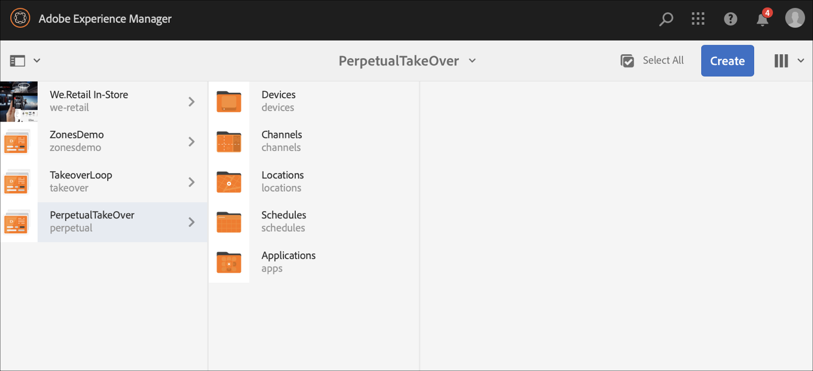
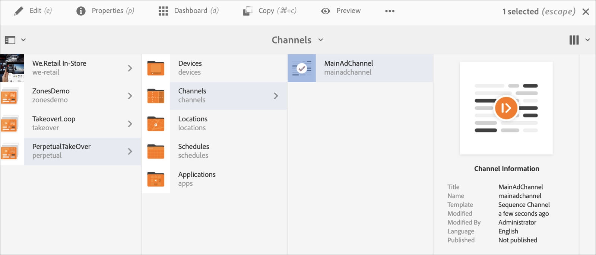
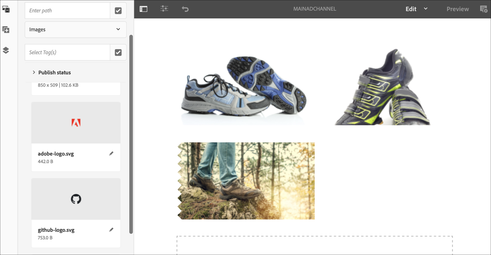
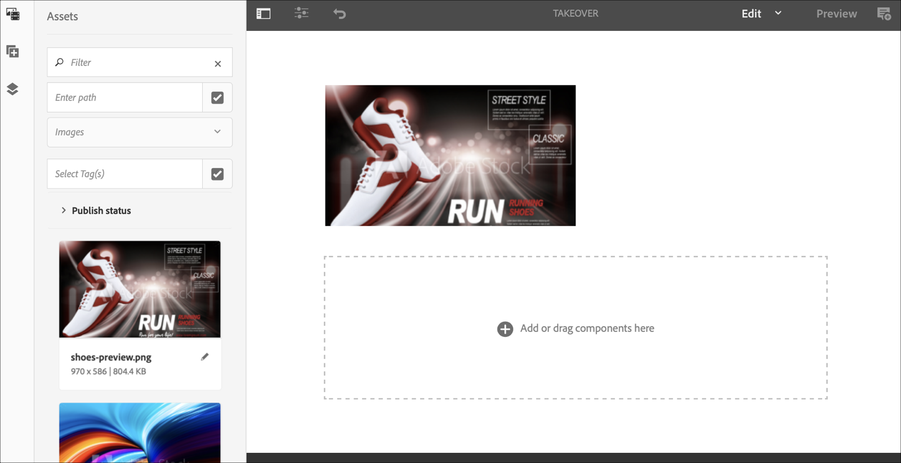
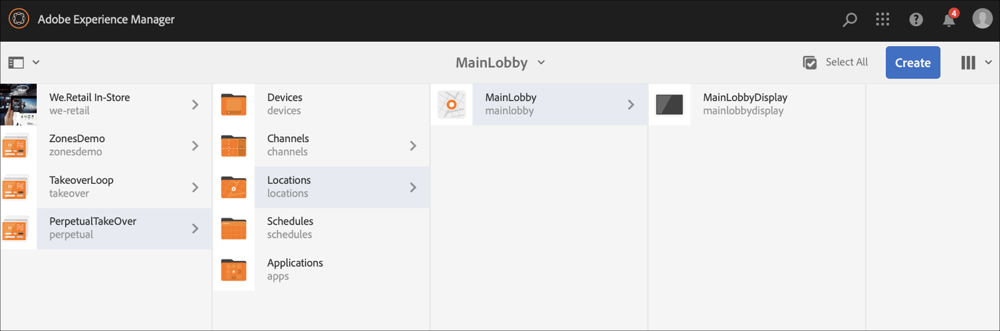
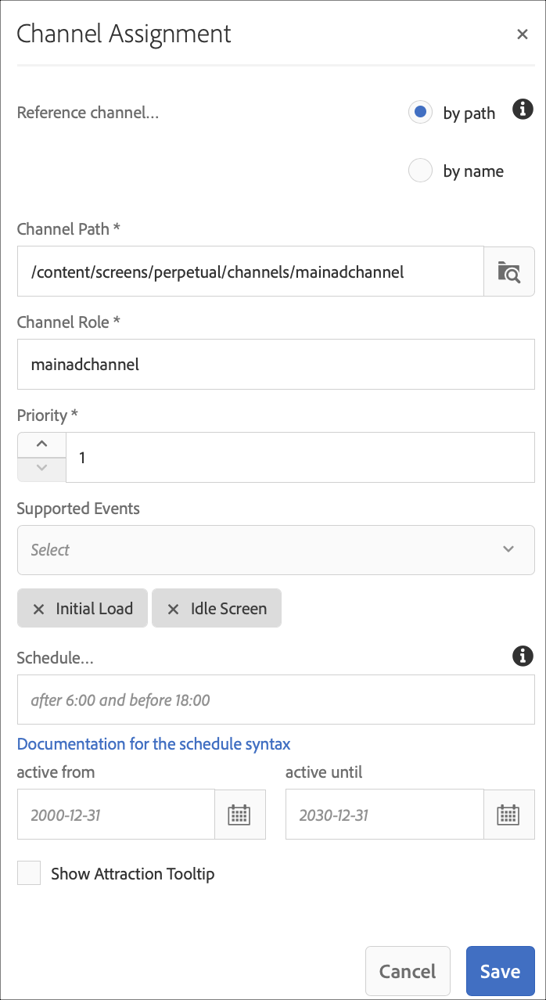
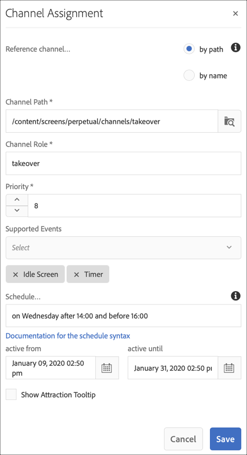
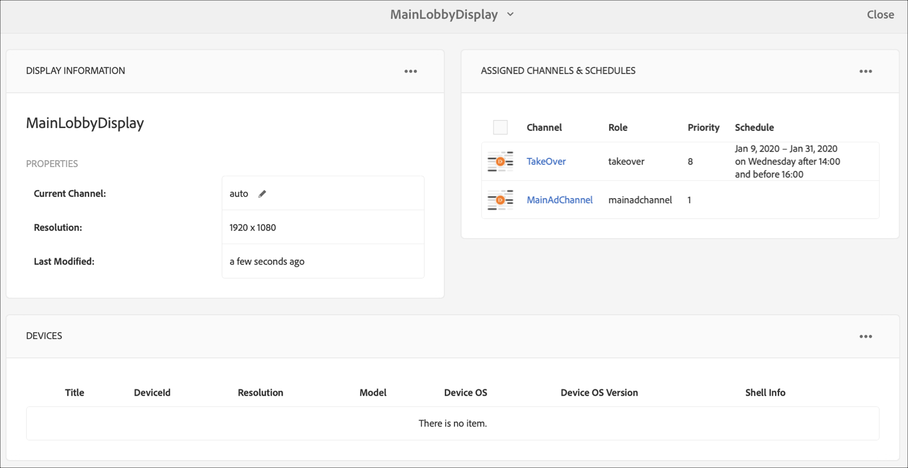

# Perpetual TakeOver Channel {#perpetual-takeover-channel}

>[!IMPORTANT]
>This content is valid for AEM on-premise/AMS (AEM 6.5LTS and AEM 6.5). For AEM as a Cloud Service Screens content refer to the [AEM as a Cloud Service guide](https://experienceleague.adobe.com/en/docs/experience-manager-cloud-service/content/screens-as-cloud-service/overview/introduction).

The following page showcases a use case that emphasizes on setting up a project on how to create a Perpetual TakeOver channel that plays for a specific time day and time continuously.

## Use case description {#use-case-description}

This use case explains how to create a channel that *takes over* from the normal playing channel for a display or group of displays. The takeover occurs for a specific day and time perpetually.
For example, there is a Perpetual TakeOver channel that plays every Friday from 9:00 A.M. through 10:00 A.M. During this time, no other channel should play. The following example showcases the creation of a perpetual takeover channel that allows the content to play every Wednesday for two hours from 2:00 P.M. through 4:00 P.M.

### Preconditions {#preconditions}

Before you start this use case, make sure you understand how to:

* **[Create and Manage Channels](managing-channels.md)**
* **[Create and Manage Locations](managing-locations.md)**
* **[Create and Manage Schedules](managing-schedules.md)**
* **[Device Registration](device-registration.md)**

### Primary Actors {#primary-actors}

Content Authors

## Setting up the Project {#setting-up-the-project}

Follow the steps below to set up a project:

**Setting up the Channels and Display**

1. Create an AEM Screens Project titled as **PerpetualTakeOver**, as shown below.

   

1. Create a **MainAdChannel** in the **Channels** folder.

    

1. Click the **MainAdChannel** and click **Edit** from the action bar. Drag and drop some assets (images, videos, embedded sequences) to your channel.

   

   >[!NOTE]
   >The **MainAdChannel** in this example demonstrates a sequence channel that plays content continuously.

1. Create a **TakeOver** channel that takes over the content in **MainAdChannel** and plays every Wednesday from 2:00 P.M. through 4:00 P.M.

1. Click the **TakeOver** and click **Edit** from the action bar. Drag and drop some assets to your channel. The following example showcases a single zone image added to this channel.

   

1. Set up a location and display for your channels. For instance, the following location **MainLobby** and display **MainLobbyDisplay** are set up for this project.

   

**Assigning Channels to a Display**

1. Click the display **MainLobbyDisplay** from the **Locations** folder. Click **Assign Channel** from the action bar so you can open the **Channel Assignment** dialog box.

   >[!NOTE]
   >To learn how to assign a channel to a display, see **[Channel Assignment](channel-assignment.md)**.

1. Populate the fields (**Channel Path**, **Priority**, and **Supported Events**) from the **Channel Assignment** dialog box and click **Save** to assign the **MainAdChannel** to your display.

    * **Channel Path**: Click the path to the **MainAdChannel** channel
    * **Priority**: Set the priority of this channel as 1.
    * **Supported Events**: Click the **Initial Load** and **Idle Screen**.

   

1. Click the display **TakeOver** from the **Locations** folder. Click **Assign Channel** from the action bar so you can assign the takeover channel.

1. Assigning the **TakeOver** channel to your display at a scheduled time. Then, populating the following fields from the **Channel Assignment** dialog box and selecting **Save**:

    * **Channel Path**: Click the path to the **TakeOver** channel
    * **Priority**: Set the priority of this channel greater than the **MainAdChannel**. For instance, the priority set in this example is 8.
    * **Supported Events**: Click the **Idle Screen** and **Timer**.
    * **Schedule**: Enter the text for the schedule that you want this channel to run on the display. The text in the **Schedule** mentioned in this example is *on Wednesday after 14:00 and before 16:00*.

         >[!NOTE]
         >To learn more about the expressions you can add to the **Schedule**, see the [Example Expressions](#example-expressions) section below.
    * **active from**: Start date and time.
    * **active until**: End date and time.
    
       For example, the text in **Schedule** and **active from** and **active until** date and time here allows the content to play every Wednesday from 2:00 P.M. until 4:00 P.M..
    

        

      Navigate to the display from **TakeOver** > **Locations** > **MainLobby** > **MainLobbyDisplay**, Then, click **Dashboard** from the action bar so you can view the assigned channels with their priorities, as shown below.

      >[!NOTE]
      >It is mandatory to set the priority of the takeover channel as the highest.

      
    Now, the **TakeOver** channel takes over the **MainAdChannel** at 2:00 P.M. for two hours until 4:00 P.M. every Wednesday and plays its content from January 09, 2020 until January 31, 2020.

## Example Expressions {#example-expressions}

The following table summarizes a few example expressions that you can add to the schedule while assigning a channel to a display.

| **Expression** | **Interpretation** |
|---|---|
| before 8:00 A.M. | the channel plays before 8:00 A.M. everyday |
| after 2:00 P.M. | the channel plays after 2:00 P.M. everyday |
| after 12:15 and before 12:45 | the channel plays after 12:15 P.M. everyday for 30 minutes |
| before 12:15 also after 12:45 | the channel plays before 12:15 P.M. everyday and then also after 12:45 P.M. |
| on the first day of January after 2:00 P.M., also on the second day of January and also on the third day of January before 3:00 A.M. | the channel starts playing after 2:00 P.M. on January 01, continues playing for the whole day on January 02 all the way until 3:00 A.M. on January 03 |
| on the 1-2 days of January after 2:00 P.M. also on the 2-3 days of January before 3:00 a.m.| the channel starts player after 2:00 P.M. on January 01, continues playing until 3:00 A.M. on January 02, then it starts again on January 02 at 2:00 P.M. and continues playing until 3:00 A.M. on January 03 |

>[!NOTE]
>
>You can also use _military time_ notation (14:00) instead of *A.M./P.M.* (2:00 P.M.).
