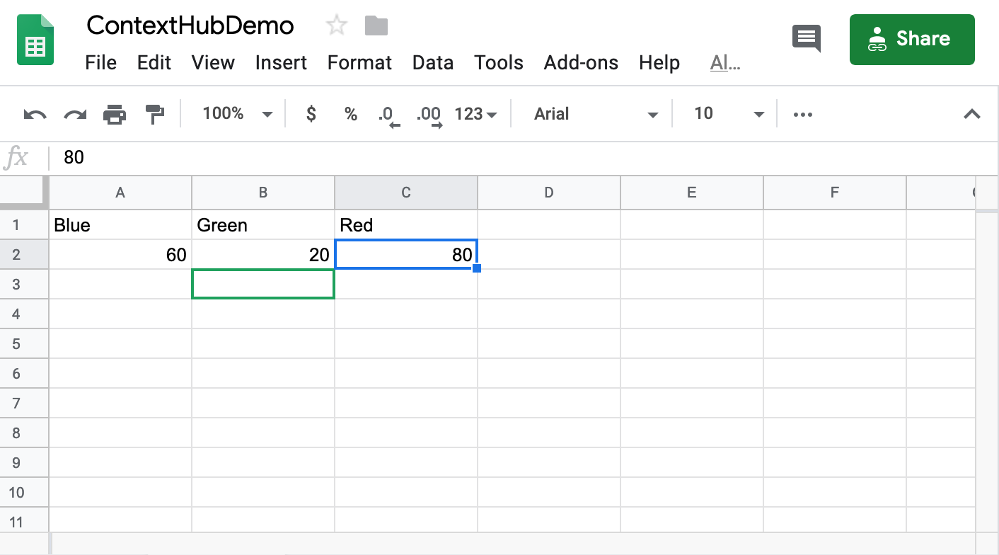
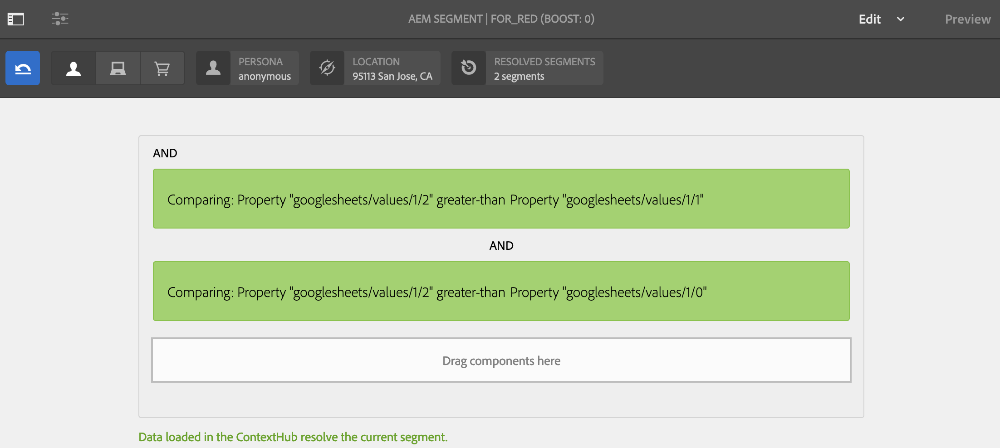
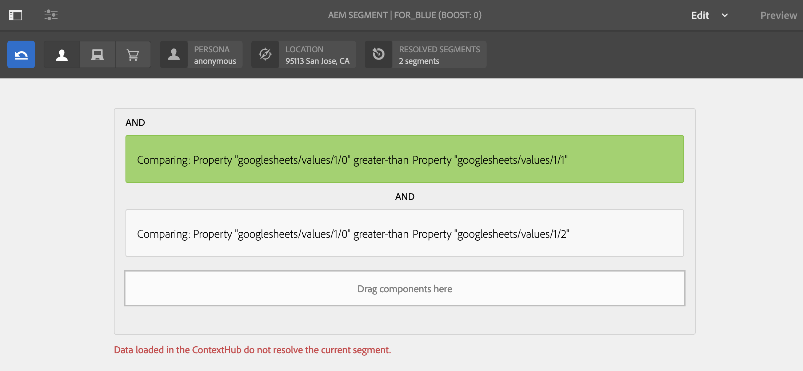
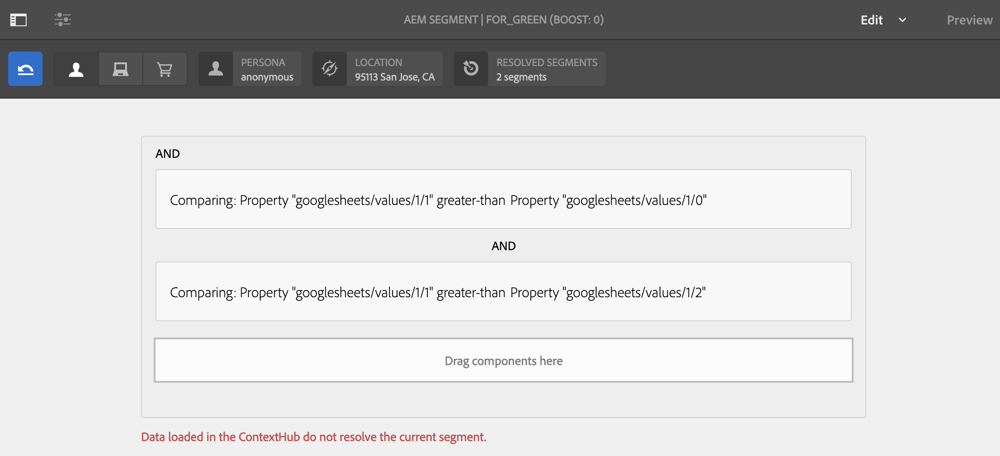
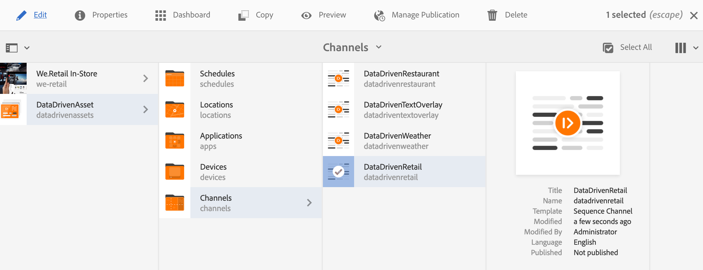
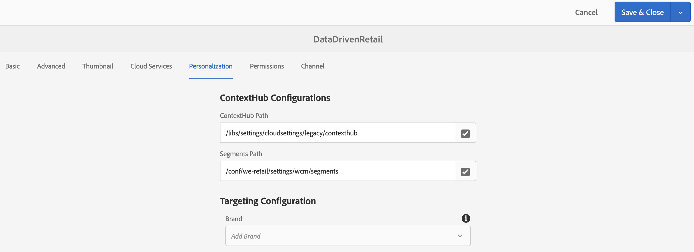
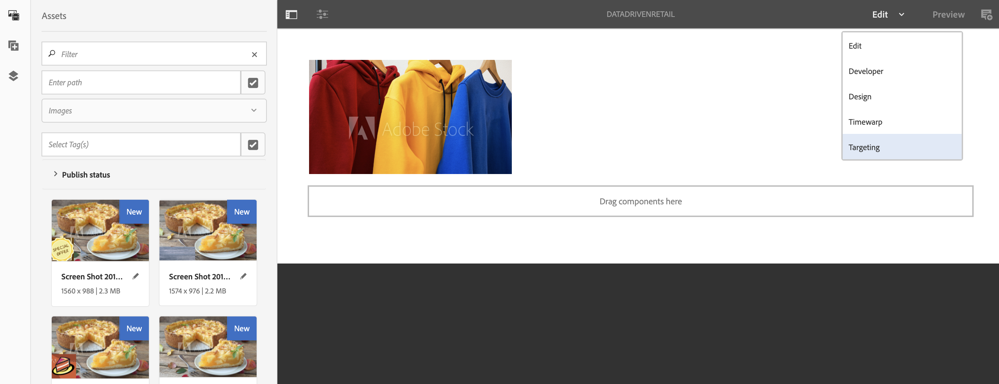
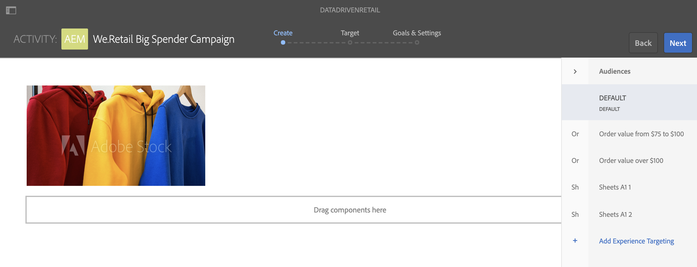
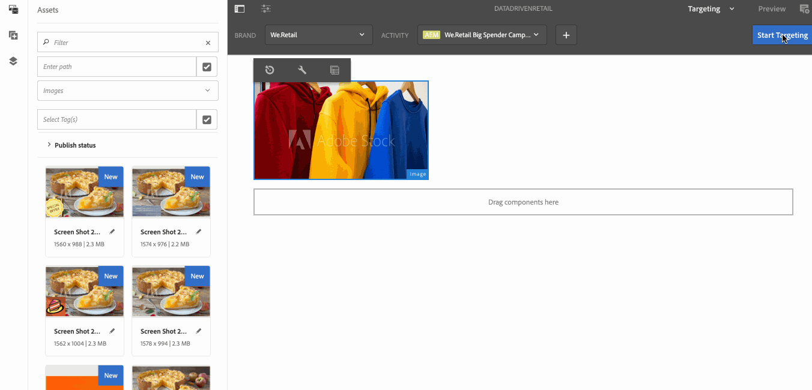
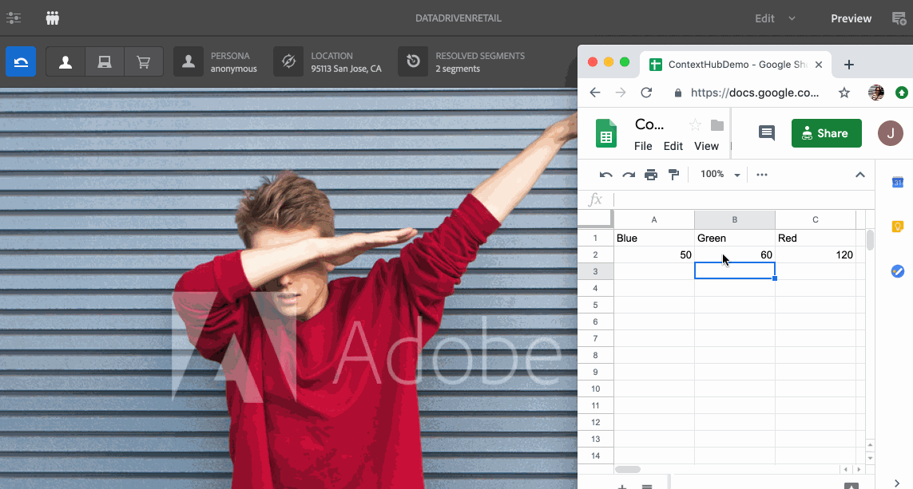

# Retail Inventory Targeted Activation {#retail-inventory-targeted-activation}

>[!IMPORTANT]
>This content is valid for AEM on-premise/AMS (AEM 6.5LTS and AEM 6.5). For AEM as a Cloud Service Screens content refer to the [AEM as a Cloud Service guide](https://experienceleague.adobe.com/en/docs/experience-manager-cloud-service/content/screens-as-cloud-service/overview/introduction).

The following use case demonstrates three different images based on the values in your Google Sheet.

## Description {#description}

This use case showcases the retail inventory stock for three different colored sweatshirts. Depending on the number of sweatshirts available in stock that is recorded in Google Sheets, the image (red, green, or blue sweatshirt) with the highest number is displayed.

The Red, Green, or Blue sweater is displayed based on the highest value of the number of sweaters available.

## Preconditions {#preconditions}

Before you start implementing the retail inventory targeting activation, learn how to set up ***Data Store***, ***Audience Segmentation*** and ***Enable Targeting for Channels*** in an AEM Screens Project.

See [Configuring ContextHub in AEM Screens](configuring-context-hub.md) for detailed information.

## Basic Flow {#basic-flow}

Follow the steps below to implement the Retail Inventory Activation use case:

1. **Populating the Google Sheets**

    1. Navigate to the ContextHubDemo Google Sheet.
    1. Add three columns (Red, Green, and Blue) with corresponding values for three different sweatshirts.

   

1. **Configuring the Audiences as per the requirements**

    1. Navigate to the segments in your audience (See ***Step 2: Setting up Audience Segmentation*** in **[Configuring ContextHub in AEM Screens](configuring-context-hub.md)** page for more details).

    1. Add three new segments **For_Red**, **For_Green**, and **For_Blue**.

    1. Click **For_Red** and click **Edit** from the action bar.

    1. Drag-and-drop the **Comparison : Property - Property** to the editor.
    1. Click the **Configuration** icon.
    1. Click **googlesheets/value/1/2** from the drop-down in **First Property name**.
    1. Click the **Operator**, and as **greater-than** from the drop-down menu.
    1. Click **Data Type**, and as **number**.
    1. Click **googlesheets/value/1/1** from the drop-down in **Second Property name**.
    1. Drag-and-drop **another Comparison : Property - Property** to the editor and click the **Configuration** icon.
    1. Click **googlesheets/value/1/2** from the drop-down in **First Property name**.
    1. Click the **Operator**, and as **greater-than** from the drop-down menu.
    1. Click **Data Type**, and as **number**.
    1. Click **googlesheets/value/1/0** from the drop-down in **Second Property name**.

   

   Similarly, edit and add comparison property rules to the **For_Blue** segment as shown in the figure below:

   

   Similarly, edit and add comparison property rules to the **For_Green** segment as shown in the figure below:

   

   >[!NOTE]
   >
   >Notice that for segments **For_Green** and **For_Green**, data cannot be resolved in the editor as only the first comparison is valid as of now as per the values in the Google Sheet.

1. Navigate and click your **DataDrivenRetail** channel (a sequence channel).
1. Click **Edit** from the action bar.

   

   >[!CAUTION]
   >
   >You should have already set up your **ContextHub** **Configurations** using the channel **Properties** > **Personalization** tab.

   

   >[!NOTE]
   >
   >Click both the **Brand** and the **Area** for the activities to be properly listed when you start the Targeting process.

1. **Adding a default image**

    1. Add a default image to your channel and click **Targeting**.
    1. Click **Brand** and the **Activity** from the drop-down menu and click **Start Targeting**.
    1. Click **Start Targeting**.

   

   >[!NOTE]
   >
   >Before you start targeting, add the segments (**For_Green**, **For_Red**, and **For_Blue**) by selecting **+ Add Experience Targeting** from the side rail as shown in the figure below.

   

1. Add the images to all the three different scenarios as shown below.

   

1. **Checking the Preview**

    1. Click **Preview.** Also, open your Google Sheet and update its value.
    1. Change the value for all three different columns. Notice the display image updates as per the highest value in the inventory.

   
