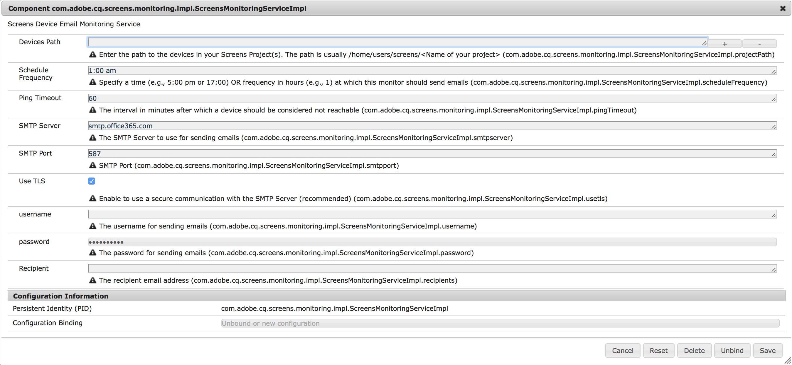

# AEM Screens Notifications Service{#aem-screens-notifications-service}

>[!IMPORTANT]
>This content is valid for AEM on-premise/AMS (AEM 6.5LTS and AEM 6.5). For AEM as a Cloud Service Screens content refer to the [AEM as a Cloud Service guide](https://experienceleague.adobe.com/en/docs/experience-manager-cloud-service/content/screens-as-cloud-service/overview/introduction).

<!--removed from metadata: admitteddomains: @adobe.com;@caesars.com-->

***AEM Screens Notifications Service*** describes monitor device activity.

This section covers the following topics:

* **Overview**
* **Configuring Email Settings**
* **Email Notification**
* **Example use case**

<!-- 
OBSOLETE NOTE>
>[!CAUTION]
>
>This AEM Screens functionality is only available, if you have installed AEM 6.3.2 Feature Pack 3 or AEM 6.4.1 Screens Feature Pack 1.
>
>To get access to this Feature Pack, contact Adobe Support and request access. After you have permissions you can download it from Package Share. 
-->

## Overview {#overview}

***AEM Screens Notifications Service*** lets administrators receive an email if an AEM Screens Player does not ping for a configurable time.

This service can be configured in the OSGi web console.

## Configuring Email Settings {#configuring-email-settings}

Follow the steps below for configuring the email notification settings:

1. Open **Adobe Experience Manager Web Console Configuration**.
1. Open **Screens Device Email Monitoring Service**.

   

1. Define the following fields so you can configure your settings for the email:

   **Devices Path** &ndash; Enter the path to the Screens Projects that you want to monitor. The path is usually `/home/users/screens/<Name of your project>`.

   For example, if your project is **`We.Retail`**, use the project path as ***/home/users/screens/we-retail***.

   >[!NOTE]
   >
   >Specify the project path, where the device users are located.

   **Schedule Frequency** &ndash; Specify a time (for example, 5:00 P.M. or 17:00) or frequency in hours (for example, 1) at which this monitor should send emails.

   **Ping Time out** &ndash; This field specifies the interval in minutes after which a device should be considered not reachable.

   **SMTP Server** &ndash; Specifies the SMTP Server that is used for sending emails.

   **SMTP Port** &ndash; Enter the SMTP Port.

   **Use TLS** &ndash; Transport Layer Security (TLS) lets you use a secure communication with the SMTP Server.

   Adobe recommends that you use TLS for secure connection to corporate mail servers. Check with your mail administrator for appropriate values.

   **username** &ndash; Specify the username for sending emails.

   **password** &ndash; Specify the password for sending emails.

   **Recipient** &ndash; Specify the recipient's email address.

   >[!NOTE]
   >
   >You can enter only one email address. To send a bulk email, create a group or distribution list with the relevant users.

1. Click **Save** to configure the monitor activity through an email for your AEM Screens device.

## Email Notification {#email-notification}

After you set the configuration for your email notifications, you receive an email notification that contains the link to the actual device that is reported of inactivity.

Accessing that link navigates you directly to the device dashboard.

Emails are only sent if:

* there is at least one device that has not pinged for the given ping timeout, and
* is still not pinging at the time of generating the email.

### Example Use Cases {#example-use-cases}

The following example describes a few scenarios for reference, to configure the properties from Screens Device Email Monitoring Service.

**Scenario 1**

You set the schedule frequency as 1:00 A.M. and the ping timeout as 60. Then, if your AEM Screens device does not ping between 12:00 P.M. until 1:00 P.M., you receive an email notification that confirms device inactivity.

**Scenario 2**

You set the schedule frequency as 1 and the ping timeout as 60. Then, if your AEM Screens device does not ping at once at any particular time of the day, you receive an email notification that confirms device inactivity.
