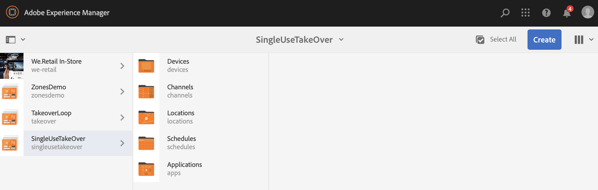
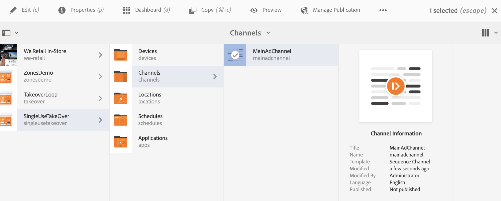
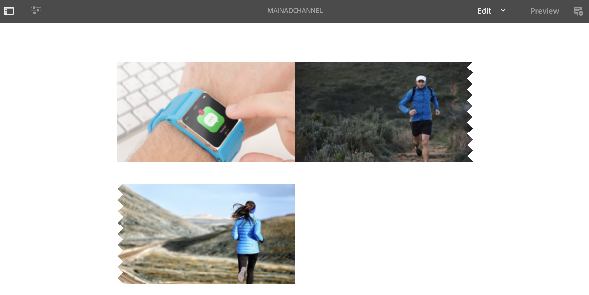
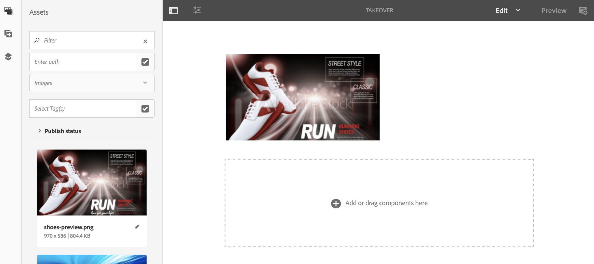
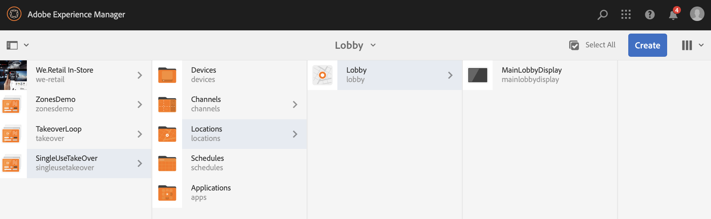
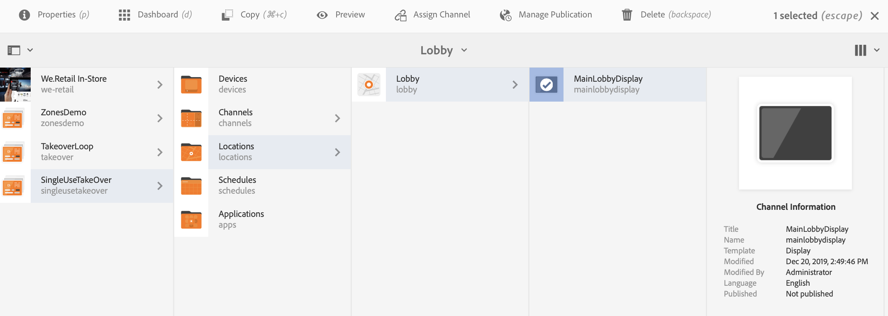
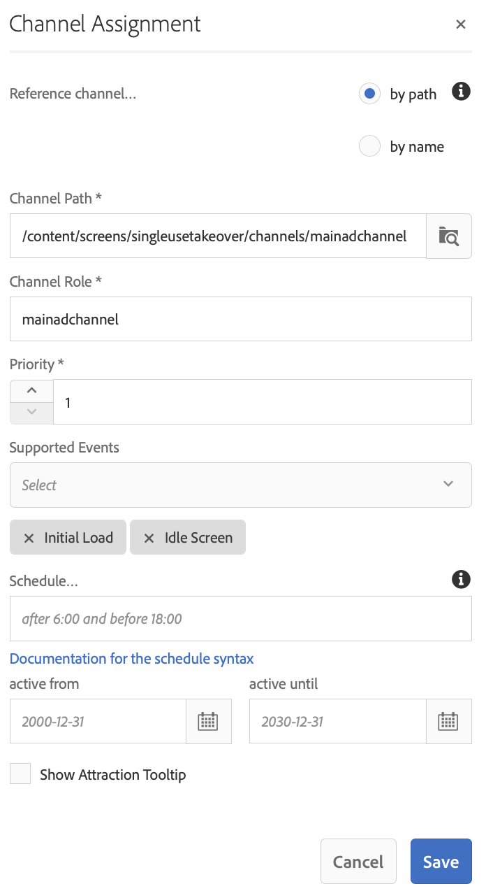
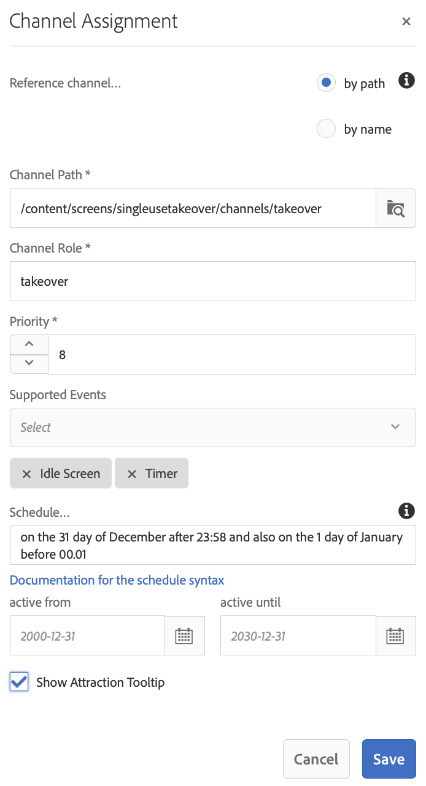
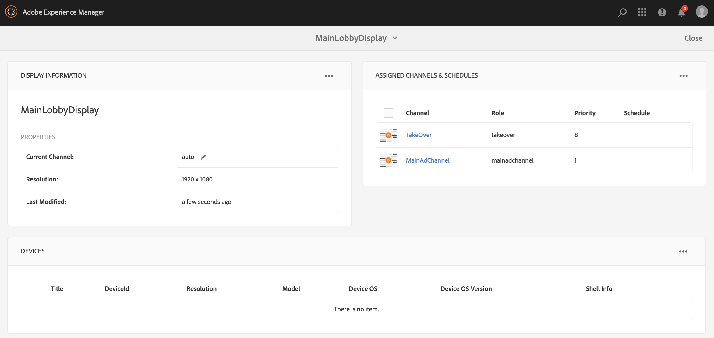

# Single Use TakeOver Channel {#single-use-takeover-channel}

>[!IMPORTANT]
>This content is valid for AEM on-premise/AMS (AEM 6.5LTS and AEM 6.5). For AEM as a Cloud Service Screens content refer to the [AEM as a Cloud Service guide](https://experienceleague.adobe.com/en/docs/experience-manager-cloud-service/content/screens-as-cloud-service/overview/introduction).

The following page showcases a use case that emphasizes on setting up a project on how to create a Single TakeOver channel that plays once for a specific time.

## Use case description {#use-case-description}

This use case explains how to create a channel that *takes over* from the normal playing channel for a display or group of displays. The takeover only occurs once and for a specific time.

For example, there is a Single TakeOver channel that plays on Friday 9:00 A.M. through 10:00 A.M. During this time, no other channel should play. Before and after this time, the Single Use Takeover channel does not play. The following example showcases the creation of a single takeover channel that allows the content to play for 2 minutes before 12:00 A.M. on Dec 31 until 12:01 A.M.

### Preconditions {#preconditions}

Before you start this use case, make sure you understand how to:

* **[Create and Manage Channels](managing-channels.md)**
* **[Create and Manage Locations](managing-locations.md)**
* **[Create and Manage Schedules](managing-schedules.md)**
* **[Device Registration](device-registration.md)**

### Primary Actors {#primary-actors}

Content Authors

## Setting up the Project {#setting-up-the-project}

Follow the steps below to set up a project:

**Setting up the Channels and Display**

1. Create an AEM Screens Project titled as **SingleUseTakeOver**, as shown below.

   

1. Create a **MainAdChannel** in the **Channels** folder.

    

1. Click the **MainAdChannel** and click **Edit** from the action bar. Drag and drop some assets (images, videos, embedded sequences) to your channel.

   

   >[!NOTE]
   >The **MainAdChannel** in this example demonstrates a sequence channel that plays content continuously.

   

1. Create a **TakeOver** channel that takes over the content in **MainAdChannel** and plays only for a specific day and time.

1. Click the **TakeOver** and click **Edit** from the action bar. Drag and drop some assets to your channel. The following example showcases a single zone image added to this channel.

   

1. Set up a location and display for your channels. For instance, the following **Lobby** location and **MainLobbyDisplay** display are set up for this project.

   

**Assigning Channels to a Display**

1. Click the display **MainLobbyDisplay** from the **Locations** folder. Click **Assign Channel** from the action bar. 

   

   >[!NOTE]
   >To learn how to assign a channel to a display, see **[Channel Assignment](channel-assignment.md)**.

1. Populate the fields (**Channel Path**, **Priority**, and **Supported Events**) from the **Channel Assignment** dialog box and click **Save**. You have now assigned the **MainAdChannel** to your display.

   

1. Click the display **TakeOver** from the **Locations** folder. Click **Assign Channel** from the action bar so you can assign the single-use takeover channel.

1. Assign the **TakeOver** channel to your display at a scheduled time and populate the following fields from the **Channel Assignment** dialog box and click **Save**:

    * **Channel Path**: Click the path to the TakeOver channel
    * **Priority**: Set the priority of this channel greater than the **MainAdChannel**. For instance, the priority set in this example is 8.

       >[!NOTE]
       >Priority can be any value that is higher than the priority value of the normal playing channel.
    * **Supported Events**: Click the **Idle Screen** and **Timer**.
    * **Schedule**: Enter the text for the schedule that you want this channel to run on the display. For example, the text here allows the content to play 2 minutes before 12:00 A.M. on Dec 31 until 12:01 A.M.
    The text in the **Schedule** mentioned in this example is *on the 31 day of December after 23:58 and also on the 1 day of January before 00.01*.

      

      Navigate to the display from **SingleUseTakeOver** > **Locations** > **Lobby** > **MainLobbyDisplay**. Click **Dashboard** from the action bar so you can view the assigned channels with their priorities, as shown below.

      >[!NOTE]
      >It is mandatory to set the priority of the takeover channel as the highest.

      

>[!NOTE]
>
>It is a best practice to delete the Single Use TakeOver channel, once it plays.
